# MiniShop

[](https://github.com/gpsv/mini-ecommerce-rn-web/actions/workflows/ci.yml)

Mini módulo de e-commerce que consume [Fake Store API](https://fakestoreapi.com/products): listado, detalle, carrito y checkout simulado. La app principal es **móvil con React Native CLI** (Android) y la secundaria es **web con React + Vite**. Las dos comparten un mismo `core/` con el dominio, el estado, la persistencia, las validaciones y los hooks.

📦 **[Descargar el APK (v1.0.0)](https://github.com/gpsv/mini-ecommerce-rn-web/releases/tag/v1.0.0)** · 📒 [Bitácora de prompts](PROMPTS.md) · 🧭 [Decisiones técnicas](DECISIONS.md) · 🛠️ [Troubleshooting](docs/troubleshooting.md)

## Capturas

### Móvil (Android, APK de release)

| Listado | Detalle | Carrito |
|:---:|:---:|:---:|
| 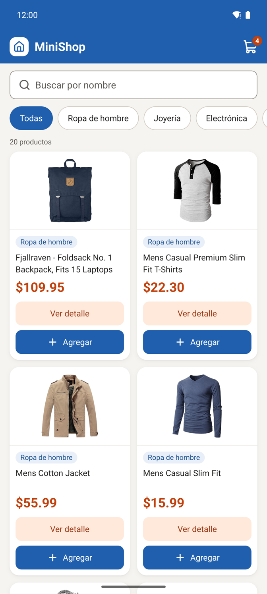 | 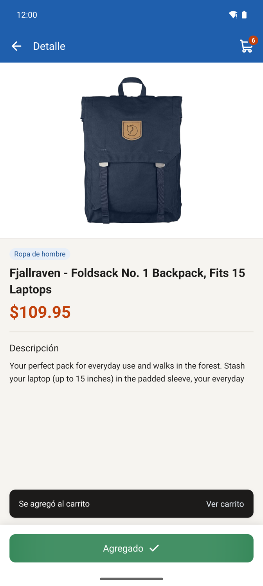 | 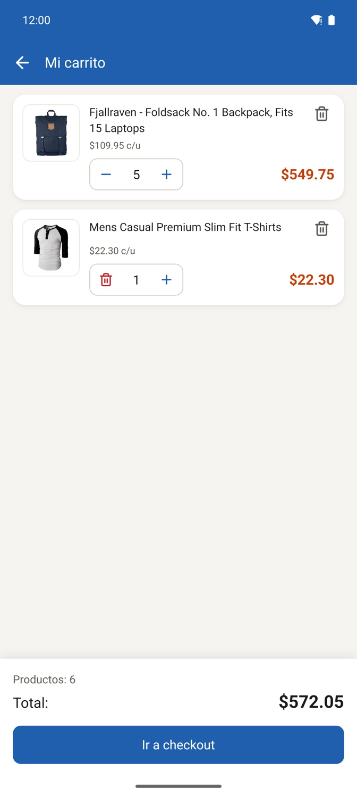 |
| **Checkout con error de validación** | **Compra confirmada** | **Sin conexión (modo avión)** |
| 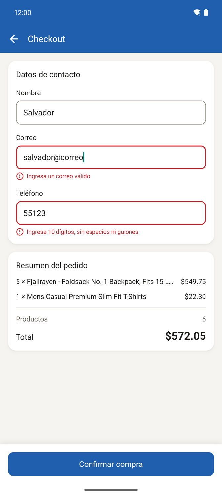 | 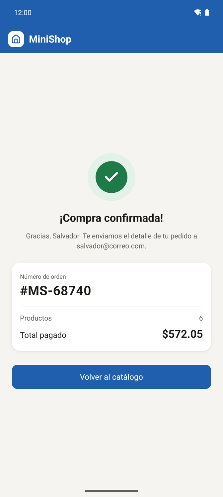 | 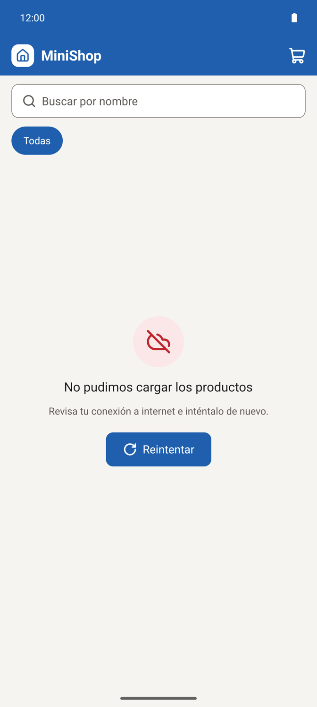 |

### Web (1440 px)

| Listado | Detalle |
|:---:|:---:|
| 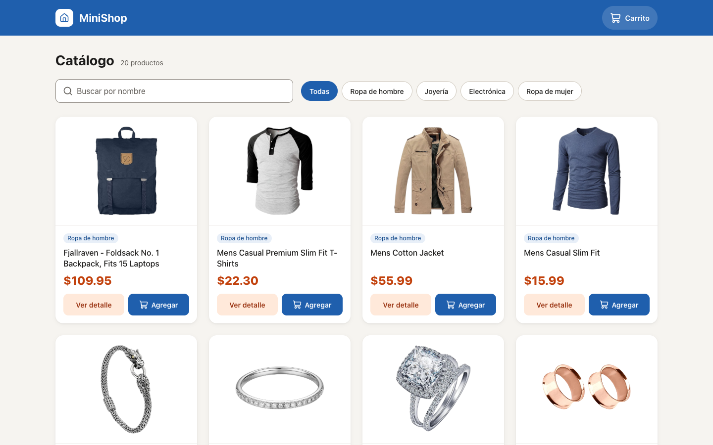 | 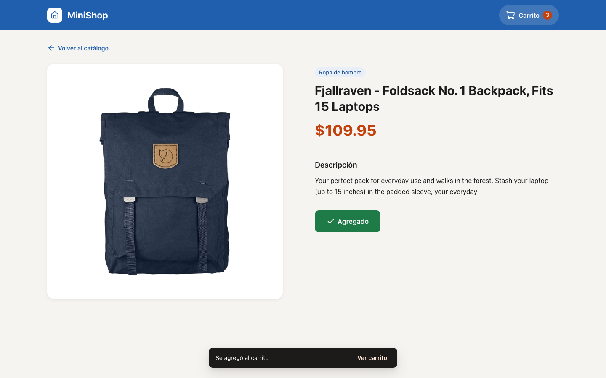 |
| **Carrito con diálogo de confirmación** | **Checkout** |
| 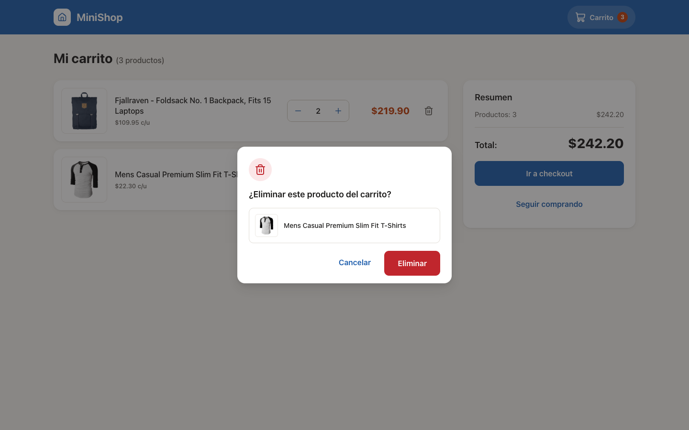 | 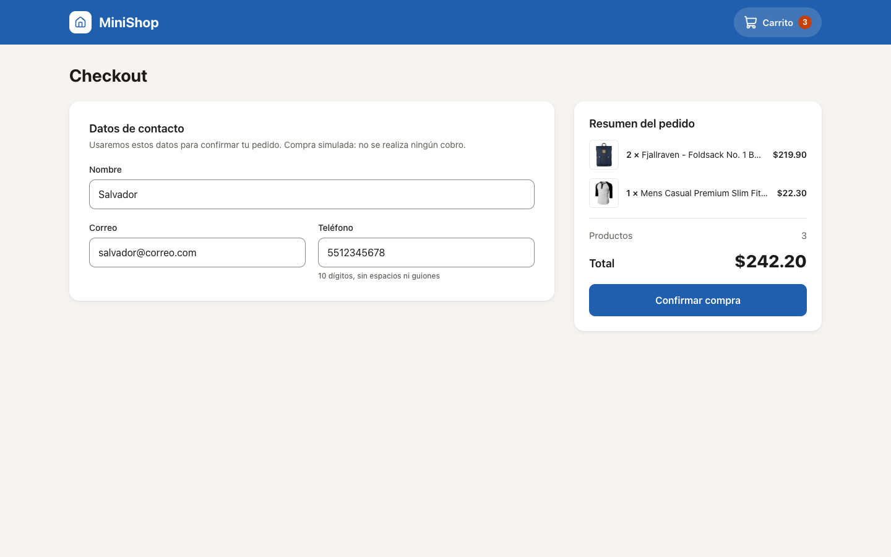 |
| **Compra confirmada** | **Error con Reintentar** |
| 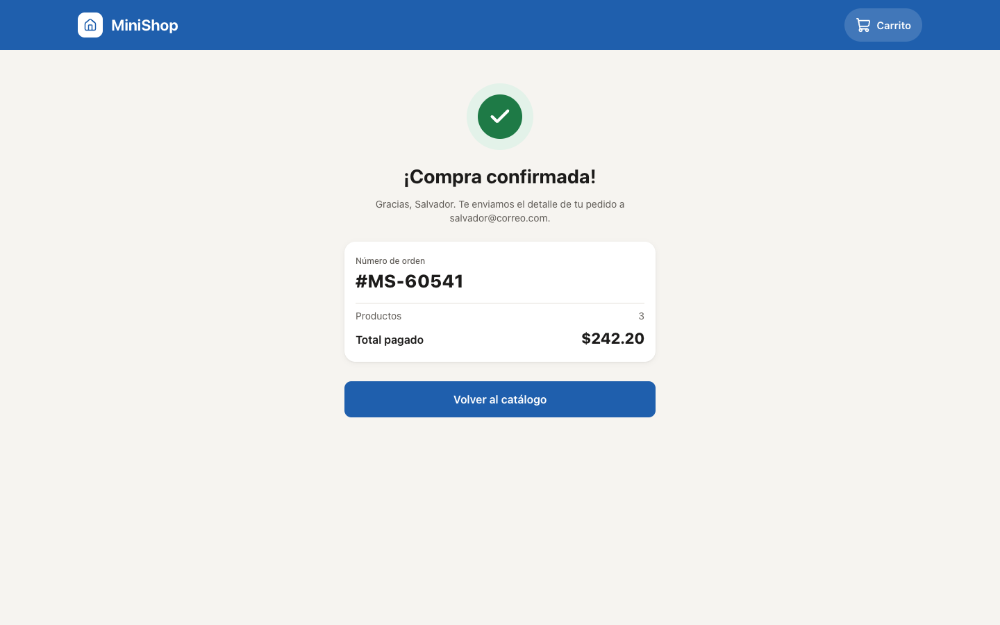 | 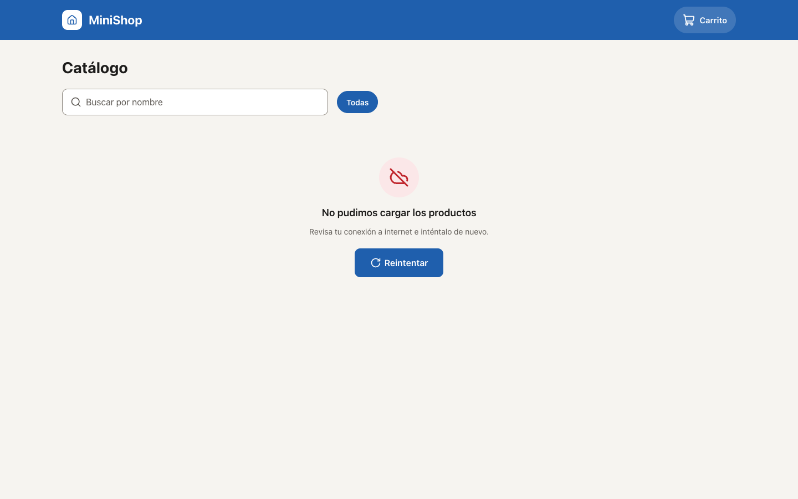 |

---

## Stack

Todas las versiones van exactas (sin `^`) en las dependencias que agregué. El criterio fue elegir la versión más probada que cubre lo necesario, no la más nueva ([D27](DECISIONS.md#d27--reduxjstoolkit-2120-en-lugar-de-2130)).

| Capa | Móvil (`mobile/`) | Web (`web/`) | Por qué |
|---|---|---|---|
| Base | React Native **0.87.1** (CLI, Hermes, Nueva Arquitectura), React 19.2.3 | React **19.3.1** + Vite **8.3.4** | CLI en lugar de Expo para controlar `android/` y Metro ([D01](DECISIONS.md#d01--react-native-cli-en-lugar-de-expo)) |
| Lenguaje | TypeScript 6 `strict` | TypeScript 6.0.3 `strict` | Las dos apps revisan `core/` ([D18](DECISIONS.md#d18--configuración-compartida-de-typescript-y-dependencias-de-soporte)) |
| Navegación | React Navigation 7 (native stack) | React Router **7.18.4** (data router) | `useBlocker` en web; rutas en español ([D43](DECISIONS.md#d43--rutas-web-en-español)) |
| Estado y datos | Redux Toolkit **2.12.0** + RTK Query, react-redux 9.3.0 | ídem, desde `core/` | Caché por endpoint y un solo store ([D03](DECISIONS.md#d03--redux-toolkit--rtk-query)) |
| Validación | Zod **4.6.7** | Zod 4.6.7 | Una sola fuente de tipos con `z.infer` ([D04](DECISIONS.md#d04--zod-como-fuente-única-de-tipos-y-validación)) |
| Formularios | React Hook Form **7.88.0** + `@hookform/resolvers` 5.9.1 | ídem | Mismo schema de checkout en ambas apps ([D36](DECISIONS.md#d36--react-hook-form-7880--hookformresolvers-591)) |
| Estilos | Uniwind **1.12.2** (Tailwind 4 para RN) | Tailwind CSS **4.3.3** | Ambos leen `design/tokens.css` ([D09](DECISIONS.md#d09--uniwind-con-tokens-compartidos), [D23](DECISIONS.md#d23--uniwind-1122)) |
| Persistencia | AsyncStorage **3.1.1** | `localStorage` | Detrás de la interfaz `StorageAdapter` de `core/` ([D29](DECISIONS.md#d29--asyncstorage-311-la-versión-mantenida)) |
| Íconos | `lucide-react-native` 1.48.0 + `react-native-svg` | `lucide-react` 1.48.0 | Mismo set en las dos plataformas ([D13](DECISIONS.md#d13--íconos-con-lucide)) |
| Pruebas | Jest 29 + RNTL **13.3.3** | Vitest **4.1.11** + Testing Library | ([D30](DECISIONS.md#d30--react-native-testing-library-1333), [D45](DECISIONS.md#d45--pruebas-web-con-vitest-y-confirmdialog-propio)) |
| Calidad | ESLint 8 (preset de RN) | ESLint 10 | Reglas de arquitectura en el lint ([D50](DECISIONS.md#d50--las-reglas-de-arquitectura-las-hace-cumplir-eslint)) + GitHub Actions ([D51](DECISIONS.md#d51--ci-en-github-actions-sin-build-de-android)) |

## Arquitectura

Un repositorio, dos apps y un `core/` compartido, **sin npm workspaces** (el hoisting rompe el autolinking de React Native CLI). `core/` no tiene `package.json`: sus imports (`zod`, `@reduxjs/toolkit`, `react`) se resuelven desde la app que lo consume, con `watchFolders` y `nodeModulesPaths` en Metro, alias y `dedupe` en Vite, `paths` en TypeScript y `babel-plugin-module-resolver` en Babel ([D02](DECISIONS.md#d02--un-repositorio-dos-apps-y-un-core-compartido)).

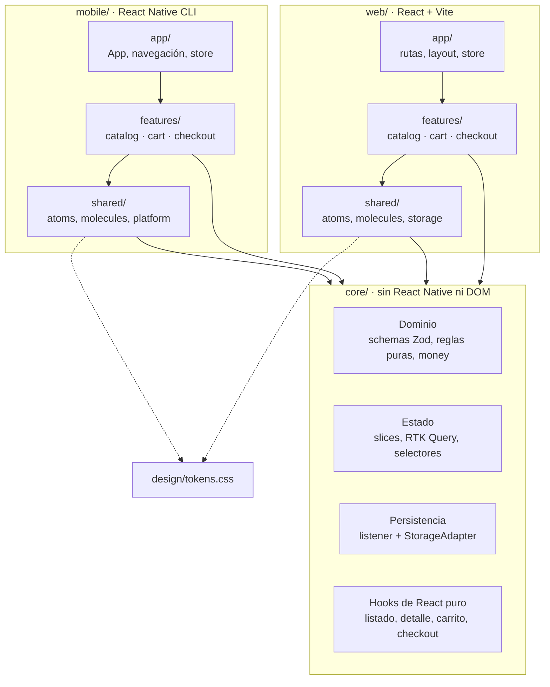

**Regla de dependencias: `features → shared → core`.** `core/` no conoce a nadie y un feature no importa archivos internos de otro (solo su `index.ts`). No es una convención escrita: **ESLint la hace cumplir en el CI** con `no-restricted-imports` y `no-restricted-globals`, con mensajes que citan la decisión que rompe la regla ([D50](DECISIONS.md#d50--las-reglas-de-arquitectura-las-hace-cumplir-eslint)).

| Lo comparte `core/` | Lo pone cada plataforma |
|---|---|
| Dominio: `ProductSchema`, `cart.rules` (1..99), `money` (centavos, `formatPrice` sin `Intl`) | Pantallas y componentes (RN `View`/`FlatList` vs HTML semántico) |
| Estado: `createAppStore`, `cartSlice`, `checkoutSlice`, `catalogApi` | El `StorageAdapter`: AsyncStorage o `localStorage` |
| Persistencia: guarda y rehidrata el carrito validando con Zod | `isDevelopment`: `__DEV__` o `import.meta.env.DEV` ([D26](DECISIONS.md#d26--createappstorestorage-options-con-entorno-y-checkout-inyectados)) |
| Validaciones: API (`rawResponseSchema`), storage y formulario | Confirmar eliminar: `Alert.alert` o `ConfirmDialog` ([D15](DECISIONS.md#d15--confirmación-de-eliminar-por-plataforma)) |
| Hooks: `useProductListing`, `usePaginatedProducts`, `useProductDetail`, `useCart`, `useCheckoutForm`, `useOrderSummary` ([D44](DECISIONS.md#d44--los-hooks-de-react-puro-viven-en-core-amplía-d11)) | Bloquear la navegación al confirmar: `BackHandler` o `useBlocker` + `beforeunload` |

En la práctica, cada plataforma solo pone sus pantallas, sus componentes y **dos adaptadores**.

## Cómo correrlo

### Requisitos

- **Node 22** (`.nvmrc`): `nvm install && nvm use`
- **JDK 17** y **Android SDK** (Android Studio) con build tools 37 y NDK 27.1, `ANDROID_HOME` configurado.
- Un emulador Android (probado con API 35) o un dispositivo con depuración USB.
- Chrome u otro navegador moderno para la web.

### Móvil

```bash
cd mobile
npm ci
npm start              # Metro; déjalo corriendo en esta terminal
npm run android        # en otra terminal, también dentro de mobile/
```

Metro se ejecuta **desde `mobile/`**, no desde la raíz. Si algo falla (puerto ocupado, pantalla negra, error viejo de `TransformError`), revisa [docs/troubleshooting.md](docs/troubleshooting.md).

APK de release local: `cd mobile/android && ./gradlew assembleRelease` → `mobile/android/app/build/outputs/apk/release/app-release.apk`.

### Web

```bash
cd web
npm ci
npm run dev            # http://localhost:5173
npm run build          # build de producción en web/dist
```

### Pruebas, lint y typecheck

Desde la raíz (delegan en cada app con `--prefix`):

```bash
npm test               # Jest (mobile + core) y Vitest (web)
npm run lint
npm run typecheck
```

Resultado actual: **Jest 27 suites / 160 pruebas** y **Vitest 6 archivos / 18 pruebas**. El CI corre lo mismo, más el build de web, en cada push y PR a `main`.

## Instalar el APK sin compilar

1. Descarga `MiniShop-v1.0.0.apk` del [Release v1.0.0](https://github.com/gpsv/mini-ecommerce-rn-web/releases/tag/v1.0.0).
2. Instálalo con `adb install -r MiniShop-v1.0.0.apk`, o arrástralo al emulador, o ábrelo en el teléfono (permite "instalar apps desconocidas").

Es un APK universal (cuatro arquitecturas), con R8 y Hermes en bytecode. Está firmado con el keystore de debug de la plantilla: sirve para evaluarlo, no para publicarlo en Play Store ([D40](DECISIONS.md#d40--apk-de-release-firmado-con-el-keystore-de-debug-con-r8)).

## Cómo se cumple cada requisito

| Requisito | Cómo | Lo prueba |
|---|---|---|
| **Listado** (imagen, título, precio, categoría; ver detalle y agregar) | `ProductListScreen` + `ProductCard` en cada app; grid de 2 columnas (móvil) y 4/3/2 (web) | `ProductCard.test`, `catalogApi.test` |
| **Detalle** (+ descripción; agregar y regresar) | Lee el producto de la caché del listado; `/producto/:id` directo en web usa el respaldo `getProductById` | `useProductDetail.test`, `routes.test` |
| **Carrito** (+, −, eliminar, total de productos y total $) | Reglas puras en centavos; en cantidad 1 el − se vuelve eliminar con confirmación ([D08](DECISIONS.md#d08--en-cantidad-1-el--se-convierte-en-eliminar-con-confirmación)) | `cart.rules`, `cart.selectors`, `money`, `QuantityStepper`, `CartScreen` (móvil y web), `ConfirmDialog` |
| **Checkout simulado** (resumen → confirmar → vaciar) | Formulario con Zod, `confirmOrder` de ~1.5 s, orden `MS-#####`, carrito vacío y persistido vacío; sin doble envío ([D25](DECISIONS.md#d25--la-orden-confirmada-guarda-su-propio-resumen), [D38](DECISIONS.md#d38--el-checkout-conserva-el-resumen-hasta-navegar-a-la-confirmación)) | `checkoutSlice.test`, `checkout.schema.test`, `CheckoutScreen` (móvil y web) |
| **Loader** | Skeleton de tarjetas en el listado; spinner en detalle, carrito y checkout | Revisión visual |
| **Error con Reintentar** | `ErrorState` en listado y detalle; errores de HTTP y de schema controlados ([D24](DECISIONS.md#d24--validar-la-api-con-rawresponseschema-no-dentro-de-transformresponse)) | `ProductListScreen.test` (móvil y web: falla → Reintentar → carga), `ErrorState.test`, `catalogApi.test` |
| **Evitar llamadas innecesarias** | `GET /products` una vez por sesión en caché de RTK Query; detalle sin petición extra; categorías derivadas; filtro y búsqueda en el cliente; paginación de 8 en el cliente | `catalogApi.test` (1 petición con varios suscriptores), `useProductDetail.test` (fetch = 1), web: 1 petición al volver del detalle. Evidencia: [Network con 1 request](docs/evidencia/network-1-request..png) |
| **Bonus: filtro por categoría** | Chips derivados de los productos; en web, `?categoria=` en la URL ([D46](DECISIONS.md#d46--filtros-del-listado-en-la-url-solo-web)) | `catalog.selectors.test`, `ProductListScreen.test` (web) |
| **Bonus: búsqueda** | Debounce de 300 ms, sin mayúsculas ni acentos; en web, `?q=` | `catalog.selectors.test`, `ProductListScreen.test` (web) |
| **Bonus: persistencia** | Listener que guarda el carrito y lo rehidrata validando con Zod; si el storage es inválido, se descarta | `cartPersistence.test`, `cart.schema.test`, `localStorageAdapter.test` |
| **React Native CLI + Android** | `@react-native-community/cli` 20.2.0, `minSdk` 24, `targetSdk` 36, APK de release | CI (job `mobile`), APK en el Release |
| **Web en React** | Vite + React Router con el mismo `core/` | CI (job `web`, con build) |
| **Uso de IA documentado** | Ver la sección siguiente | [PROMPTS.md](PROMPTS.md), [DECISIONS.md](DECISIONS.md) |

## Uso de IA

Trabajé con **Claude Code** en VS Code (desarrollo) y Claude en chat (planeación inicial y diseño en Claude Design). La forma de trabajo fue siempre la misma:

1. **Contexto por escrito una sola vez:** [`CLAUDE.md`](CLAUDE.md) con alcance, stack, arquitectura, reglas de negocio, nombres y forma de trabajo. Claude Code lo lee en cada sesión, así no repito reglas en cada prompt.
2. **Plan mode en cada tarea:** primero un plan con archivos, versiones exactas y preguntas; yo lo reviso, respondo y apruebo (a veces con condiciones, como "máximo 2 intentos para resolver un crash de R8"). Nada se instala ni se hace commit sin mi aprobación.
3. **Verificación propia:** después de cada prompt corrí typecheck, lint y pruebas, y revisé el resultado en el emulador Android y en Chrome (incluida la pestaña Network para comprobar la petición única).
4. **Registro:** cada prompt, por qué lo escribí así, lo que hizo la IA y lo que corregí está en [**PROMPTS.md**](PROMPTS.md); las decisiones, con quién las propuso, en [**DECISIONS.md**](DECISIONS.md).

### Dónde corregí o mejoré lo que propuso la IA

- **Hooks de RTK Query en `core/` (P01, [D11](DECISIONS.md#d11--core-puede-usar-reduxjstoolkitqueryreact)).** La IA recomendó no usar React en `core/` y generar los hooks en cada app. Lo rechacé: duplicaba `createApi` y complicaba el store sin ganar independencia real. Más adelante eso permitió mover a `core/` casi toda la lógica de UI ([D44](DECISIONS.md#d44--los-hooks-de-react-puro-viven-en-core-amplía-d11)).
- **Un bug que encontré revisando el plan (P08, [D38](DECISIONS.md#d38--el-checkout-conserva-el-resumen-hasta-navegar-a-la-confirmación)).** Noté que al confirmar, el carrito se vaciaba antes de navegar y el checkout mostraría "0 / $0.00" un instante. Al verificarlo, era peor: el botón "Confirmar compra" se volvía a habilitar y permitía un doble envío. Quedó corregido y con una prueba que falla sin la corrección.
- **Accesibilidad con la fuente agrandada (P09, [D41](DECISIONS.md#d41--fuente-del-sistema-agrandada-sin-perder-getitemlayout-exacto-cierra-el-riesgo-de-d34)).** Pedí explícitamente no desactivar el escalado de fuente en toda la app (el atajo común) y conservar `getItemLayout` exacto. También pedí ocultar el contador "0 productos" que aparecía durante el error de red.
- **Web: rol del diálogo y filtros en la URL (P10, [D45](DECISIONS.md#d45--pruebas-web-con-vitest-y-confirmdialog-propio), [D46](DECISIONS.md#d46--filtros-del-listado-en-la-url-solo-web)).** Cambié `role="dialog"` por `alertdialog` (acción destructiva) y pedí guardar búsqueda y categoría en la URL, porque al volver del detalle se perdían. `core/` no debía depender de React Router, así que el hook acepta estado controlado opcional y móvil no cambió.
- **Revisión visual en Chrome (P10, [D49](DECISIONS.md#d49--web-botones-de-la-tarjeta-con-container-query-y-checkout-en-orden-de-lectura)).** Encontré botones truncados ("Ver det...") y el botón "Confirmar compra" arriba del formulario en pantallas angostas. Pedí container queries en la tarjeta y que el orden del DOM coincidiera con el visual (no CSS `order`), para que el orden de Tab siga lo que se ve.

## Decisiones clave

Resumen; el detalle, las alternativas y quién propuso cada una están en [DECISIONS.md](DECISIONS.md).

1. **`core/` compartido sin workspaces** ([D02](DECISIONS.md#d02--un-repositorio-dos-apps-y-un-core-compartido)): se comparte lo que cambia por reglas de negocio, no la UI.
2. **Dinero en centavos enteros** ([D05](DECISIONS.md#d05--dinero-en-centavos-enteros)) y `formatPrice` sin `Intl` ([D12](DECISIONS.md#d12--formatprice-determinista-sin-intl)): totales exactos e iguales en Hermes, Node y navegadores.
3. **El detalle lee la caché del listado** ([D06](DECISIONS.md#d06--detalle-sin-llamada-extra-a-la-api), [D32](DECISIONS.md#d32--el-detalle-lee-el-producto-de-la-caché-del-listado)): `/products/:id` solo como respaldo para links directos en web.
4. **Paginación en el cliente** ([D07](DECISIONS.md#d07--lazy-load-con-paginación-en-el-cliente), [D33](DECISIONS.md#d33--paginación-del-lado-del-cliente-sobre-la-caché)): la API no pagina; el hook aísla la estrategia.
5. **En cantidad 1, el − se vuelve eliminar con confirmación** ([D08](DECISIONS.md#d08--en-cantidad-1-el--se-convierte-en-eliminar-con-confirmación)).
6. **Validar la API con `rawResponseSchema`** ([D24](DECISIONS.md#d24--validar-la-api-con-rawresponseschema-no-dentro-de-transformresponse)): un error controlado en lugar de una excepción no manejada.
7. **Inversión de dependencias en el store** ([D26](DECISIONS.md#d26--createappstorestorage-options-con-entorno-y-checkout-inyectados)): storage, entorno, retraso y número de orden se inyectan; las pruebas no esperan ni dependen del azar.
8. **Checkout ocupado hasta navegar** ([D38](DECISIONS.md#d38--el-checkout-conserva-el-resumen-hasta-navegar-a-la-confirmación)): sin "$0.00" intermedio ni doble envío.
9. **Hooks de React puro en `core/`** ([D44](DECISIONS.md#d44--los-hooks-de-react-puro-viven-en-core-amplía-d11)): cada plataforma solo pone pantallas, componentes y dos adaptadores.
10. **Arquitectura verificada por ESLint** ([D50](DECISIONS.md#d50--las-reglas-de-arquitectura-las-hace-cumplir-eslint)): las reglas de `CLAUDE.md` fallan en el CI si se rompen.

## Limitaciones conocidas

- **Firma con el keystore de debug** ([D40](DECISIONS.md#d40--apk-de-release-firmado-con-el-keystore-de-debug-con-r8)): válido para evaluar, no para publicar.
- **iOS no se compila.** El código evita APIs exclusivas de Android y el bundle de Metro para iOS compila, pero no se probó en un simulador.
- **Sombras en Android 7–8** ([D21](DECISIONS.md#d21--sombras-boxshadow-desde-tokens-con-respaldo-para-android-7-y-8)): el respaldo con `elevation` tiene prueba unitaria, pero no se revisó en un emulador API 24–27.
- **Sin selector de cantidad en el detalle** ([D48](DECISIONS.md#d48--sin-selector-de-cantidad-en-el-detalle)): se agrega de uno en uno y se ajusta en el carrito.
- **La página de la paginación no está en la URL** ([D46](DECISIONS.md#d46--filtros-del-listado-en-la-url-solo-web)): al volver del detalle en web, el listado empieza en la página 1.
- **Sin deep links en móvil ni modo offline del catálogo** ([D16](DECISIONS.md#d16--sin-deep-links-en-móvil-fallback-del-detalle-para-web), [D17](DECISIONS.md#d17--caché-de-catálogo-por-sesión)): la caché es por sesión; solo el carrito se persiste.
- **Aviso de `braces` en `npm audit` de mobile** ([D52](DECISIONS.md#d52--aviso-de-braces-en-mobile-no-se-actúa)): solo en herramientas de desarrollo, no llega al APK y no hay versión corregida.
- **APK de ~73 MB** por ser universal; uno solo para arm64 pesaría ~25 MB.

## Siguientes pasos

- Keystore propio fuera del repo (o Play App Signing) y APKs/AAB por arquitectura.
- Job de Android en el CI con caché de Gradle, que adjunte el APK al Release.
- Deep links en móvil (`linking` de React Navigation), reutilizando el respaldo `getProductById` que ya existe.
- Probar en simulador iOS y en un emulador API 24–27.

### Cómo agregaría…

**Selector de cantidad en el detalle ([D48](DECISIONS.md#d48--sin-selector-de-cantidad-en-el-detalle)).**
- `core/`: una regla `addItem(items, product, quantity)` en `cart.rules.ts` que respete el tope de 99 y devuelva la misma referencia si no cambia nada ([D28](DECISIONS.md#d28--las-reglas-del-carrito-devuelven-la-misma-referencia-si-no-cambian-nada)), con su prueba; el reducer de `cartSlice` solo delega, y `useAddToCart` recibe la cantidad.
- Cada app: el `QuantityStepper` que ya existe en `shared/`, colocado en la pantalla de detalle. Sin lógica nueva en las pantallas.

**Paginación del servidor.**
- `core/`: un endpoint `getProductsPage({ page })` en `catalogApi` con `serializeQueryArgs` + `merge` de RTK Query para acumular páginas, validado con el mismo `ProductListSchema`.
- `usePaginatedProducts` cambia su fuente de datos (pide la siguiente página en `loadMore` y expone `hasMore` según la respuesta) y conserva su interfaz, así que **las pantallas no cambian**: la `FlatList` ya llama `onEndReached` y la web ya usa `IntersectionObserver`.
- El filtro y la búsqueda pasarían al servidor como argumentos del endpoint, si la API los soportara.

**Un feature nuevo (por ejemplo, favoritos) o una plataforma nueva.**
- `core/favorites/`: `favorites.schema.ts` (tipos con `z.infer`), `favorites.rules.ts` con pruebas, `favoritesSlice.ts`, persistencia con el mismo patrón de listener + `StorageAdapter`, selectores y un hook `useFavorites`.
- Cada app: `features/favorites/` con su pantalla, componentes e `index.ts` público; agregarlo a la lista `FEATURES` de ESLint para que las reglas de importación lo cubran.
- Una plataforma nueva (por ejemplo, desktop con Electron o una app de iOS dedicada) solo implementa `StorageAdapter`, pasa `isDevelopment` a `createAppStore` y escribe sus pantallas; dominio, estado, validaciones y hooks ya están en `core/`.

## Estructura del repositorio

```
core/        Dominio, estado, persistencia, validaciones y hooks (compartido)
mobile/      App React Native CLI (Android primero, iOS listo)
web/         App React + Vite
design/      tokens.css compartido, referencia y capturas del diseño (Claude Design)
docs/        troubleshooting.md, evidencias y capturas
CLAUDE.md    Contexto para Claude Code
PROMPTS.md   Bitácora de prompts
DECISIONS.md Decisiones técnicas (D01–D52)
```
